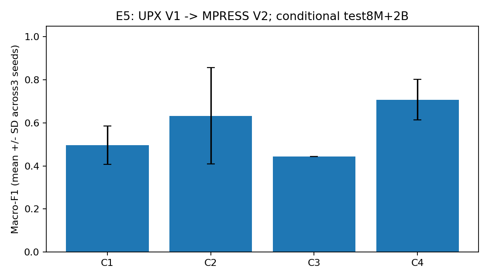

# Byteplot CNN: Entropy and PE Structure Under Packing

**IAM302t · Group 6 · Python / PyTorch · Static malware research**

A three-channel byteplot CNN pipeline for studying whether local entropy and PE structure add useful information under executable packing. The implementation covers five experiment groups **E1–E5**, plus **E0** data auditing, with parent-grouped evaluation and a reproducible CPU synthetic demo.

This repository includes **182 redacted disarmed-PE static audit records** and a **scoped UPX → MPRESS E5 pilot**: four configurations, three seeds, and the same **10 independent test parents**. These are conditional pilot findings, not a general malware-detection benchmark.

## Completed work and scope

| Work | Status | Evidence |
| --- | --- | --- |
| CNN, channel encoders and E0–E5 evaluation tooling | Implemented; exercised on synthetic data | [Source](byteplot/), [tests](tests/), [running guide](RUNNING.md) |
| Core software verification | 71 pytest tests passed, one symlink-capability test skipped on the verified Windows host | [Verification record](verification/RESULTS.json), [review](REVIEW.md) |
| CPU synthetic workflow | 96 variant rows / 24 parents; 17 classifier runs and one entropy probe; E0–E5 all exercised | [Verification record](verification/RESULTS.json), [demo script](scripts/run-demo.ps1) |
| Static PE audit | 182 redacted records; all parsed | [CSV](audit_182/Static182_audit_redacted.csv), [export receipt](audit_182/STATIC182_REDACTED_EXPORT_RECEIPT.json) |
| UPX → MPRESS cross-packer evaluation | Completed at conditional pilot scale: 12 runs on 10 test parents | [Per-run results](results_e5_summary/E5_RESULTS.csv), [summary](results_e5_summary/E5_CHANNEL_SUMMARY.csv), [protocol](results_e5_summary/E5_STATUS.json) |
| Larger source/toolchain-matched cohort, external holdout and broader packer evaluation | Future work; unresolved | [Requirements status](results_e5_summary/TEACHER_REQUIREMENTS_STATUS.json) |

Implemented recipes and synthetic verification do not establish completed real-data results for every experiment group. Real E5 checkpoints, parent-level predictions and private feature manifests are not distributed; the included checks validate saved aggregate arithmetic, not independent research-training replay.

## Architecture and evaluation suite

The encoder aligns each pixel with a byte offset in a fixed prefix, with a default real-data capacity of **256 × 256 = 64 KiB**:

- **Byteplot:** grayscale byte values normalized by 255.
- **Local entropy:** Shannon entropy in 256-byte windows, stride 64; overlapping values are averaged over observed bytes and normalized by 8.
- **PE structure map:** `pefile` labels header, section, heuristic packer stub and overlay regions. This structural map is the third input channel in C4.

A separate **valid-byte padding mask** controls feature pooling and probe loss for all configurations. It is not a fourth CNN input channel. The CNN has three convolution blocks with 16/32/64 features, GroupNorm, ReLU, max pooling, masked pooling and a two-class head. See [representation.py](byteplot/representation.py) and [models.py](byteplot/models.py).

| Configuration | CNN input |
| --- | --- |
| C1 | Byteplot |
| C2 | Byteplot + local entropy |
| C3 | Byteplot + PE structure map |
| C4 | Byteplot + local entropy + PE structure map |

| Group | Implemented evaluation |
| --- | --- |
| E0 | Split/label/pair coverage, packing outcomes, truncation/padding and metadata artifact baseline |
| E1 | Packing degradation from V0; paired V0/V1/V1u static-unpacking baseline |
| E2 | C1–C4 channel comparison under equivalent train/validation conditions |
| E3 | C1/C2 learning curves and grayscale-to-entropy probe |
| E4 | Rare versus balanced benign-packed training; fixed validation/test conditions |
| E5 | V1 training/validation and V2 testing; no V2 checkpoint selection |

Variants from the same `parent_sha256` stay in the same split. Evaluation includes Macro-F1, parent-cluster bootstrap intervals, paired label flips, benign-packed FPR with Wilson intervals, and exact McNemar comparisons. See [experiments.py](byteplot/experiments.py), [metrics.py](byteplot/metrics.py) and [io.py](byteplot/io.py).

## Static PE audit: 182 disarmed records

Static parsing with **pefile** and **Detect It Easy (DiE)** produced:

| Observation | Records |
| --- | ---: |
| Parsed successfully | 182 / 182 |
| DiE clean | 102 |
| DiE packed | 58 |
| DiE unknown | 22 |
| Longer than the 64 KiB representation prefix | 145 / 182 (79.67%) |

The [redacted CSV](audit_182/Static182_audit_redacted.csv) uses ordinal aliases and removes sample hashes, identities, families, paths, exact sizes and free-text tool output. Its checksum is bound to the [export receipt](audit_182/STATIC182_REDACTED_EXPORT_RECEIPT.json). Rechecking this metadata does not rerun PE analysis.

**Interpretation:** DiE “clean” means no recognized packing detection; it does not prove a file is unpacked or safe. The 182 records describe a selected static audit, not the classifier's test size or the full BODMAS dataset. Prefix truncation omits bytes from the image; it does not mean the PE was physically truncated. Packing compatibility and source/toolchain differences introduce selection bias. The pilot retained a conditional cohort of 42 malware and eight benign parents; its ten-parent test set is separate from the 182-record audit. Earlier diagnostic findings and their dates are documented in the [audit notes](audit_182/README.md).

The earlier [E0 narrative](audit_182/E0_ANALYSIS_REPORT.md) records that all 42 Windows benign samples in the original cohort failed the standard UPX compatibility setup. It also reports a Rich/linker-only diagnostic Macro-F1 of 0.9800 on its separate V0 cohort/folds, motivating source controls. That diagnostic is not a CNN score or a direct ablation against the conditional paired cohort.

## Scoped cross-packer pilot: UPX → MPRESS (E5)

Training and validation used **UPX V1** (31 and nine parents respectively); testing used **MPRESS V2**, with eight malware and two benign parents. C1–C4 each ran with seeds **17, 37, 73**, for **12 runs** of ten epochs. Checkpoints were selected by V1 validation Macro-F1, with a fixed classification threshold of 0.5.

| Configuration | Mean Macro-F1 | Sample SD across three seeds | Mean FPR across three seeds |
| --- | ---: | ---: | ---: |
| C1 | **0.4963** | 0.0898 | 0.8333 |
| C2 | **0.6329** | 0.2234 | 0.3333 |
| C3 | **0.4444** | 0.0000 | 1.0000 |
| C4 | **0.7079** | 0.0935 | 0.1667 |



Sources: [per-run confusion matrices and scores](results_e5_summary/E5_RESULTS.csv), [channel summary](results_e5_summary/E5_CHANNEL_SUMMARY.csv), [protocol and limitations](results_e5_summary/E5_STATUS.json), [verification scope](results_e5_summary/E5_VERIFICATION.json).

**Methodological limits:**

- All three seeds share the **same 10 independent test parents**, including **only two benign parents**. Seeds do not create 30 independent observations; the SD describes training variation.
- With two benign test parents, per-run FPR moves in increments of 0.5. A zero observed FPR still has a Wilson 95% upper bound of approximately 0.6576.
- Source/compiler/linker confounding remains unresolved. The UPX-compatible cohort is not representative of all BODMAS samples or all packers.
- The PE-region encoder contains known packer-name heuristics, including MPRESS. “Unseen packer” refers to CNN training inputs, not an encoder with no prior MPRESS knowledge.
- C3 predicted every test parent as malware in all three runs. Degenerate bootstrap intervals do not establish population certainty. The six paired correctness comparisons do not establish a significant difference after Holm correction; they are not direct tests of Macro-F1 differences.
- Static V2 checks do not establish execution equivalence. Checkpoint replay, parent-prediction replay and independent bootstrap-CI reconstruction are outside this published evidence.

## Run a safe CPU demo

Use Python 3.12 from the repository root. The commands below create a local environment and install CPU PyTorch; no research datasets are downloaded.

```powershell
py -3.12 -m venv .venv
.\.venv\Scripts\python.exe -m pip install torch --index-url https://download.pytorch.org/whl/cpu
.\.venv\Scripts\python.exe -m pip install -r requirements.txt
.\.venv\Scripts\python.exe -m pytest -q
.\.venv\Scripts\python.exe -m byteplot demo --out demo-output --parents-per-class 12 --epochs 1 --seed 17
.\.venv\Scripts\python.exe workspace_tools/verify_artifacts.py metrics --root demo-output/runs
```

The demo uses synthetic byte sequences: zlib and XOR transformations stand in for packing, and PE regions are mocked. Synthetic scores verify workflow behavior; they are not malware-detection performance. Generated arrays, synthetic payloads and checkpoints remain ignored. Use a new output directory for each run.

Check the published evidence without training:

```powershell
.\.venv\Scripts\python.exe workspace_tools/verify_artifacts.py audit
.\.venv\Scripts\python.exe workspace_tools/verify_artifacts.py e5
```

See [RUNNING.md](RUNNING.md) for Linux commands, inference and the VM-only research workflow; [REVIEW.md](REVIEW.md) explains validation and provenance.

## Repository map

| Path | Contents |
| --- | --- |
| [byteplot/](byteplot/) | Encoder, CNN/probe, training, evaluation, reporting and static-audit CLI |
| [tests/](tests/) | Core software tests using synthetic and mocked fixtures |
| [scripts/](scripts/) | Setup/demo runners and auxiliary metadata research controls |
| [workspace_tools/](workspace_tools/) | Read-only consistency checks for released evidence and generated synthetic metrics |
| [audit_182/](audit_182/) | Redacted static audit records and provenance receipts |
| [results_e5_summary/](results_e5_summary/) | E5 aggregate tables, plot, protocol and verification records |
| [verification/RESULTS.json](verification/RESULTS.json) | Sanitized local verification record |

## Data handling and future work

The publication contains code, an empty manifest template, redacted audit metadata and aggregate evidence. It excludes raw PE samples, identity-bearing manifests, real feature arrays, research checkpoints, archives and VM images. Real sample handling belongs in an isolated, authorized VM; samples are not executed by the audit. Auxiliary [research controls](scripts/research_controls/README.md) retain historical checksum/scope gates and need private inputs that are not distributed here.

Next research steps are a sufficiently large source/toolchain-matched cohort, a fresh external holdout, complete matched-cohort classifier evaluation and broader packer coverage. These remain future work. The reported pilot does not demonstrate that entropy generally improves malware detection.
